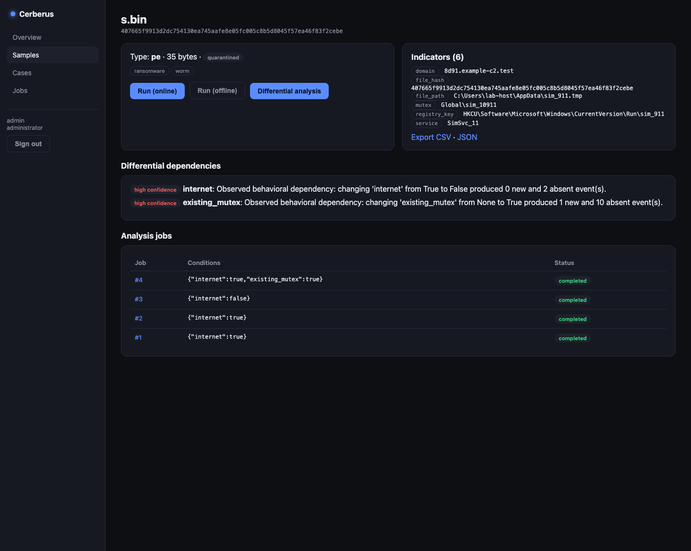

# Cerberus

A defensive malware analysis sandbox for **authorized laboratory environments**.

Cerberus ingests a suspicious sample, runs it under controlled conditions,
collects normalized behavioral telemetry, and turns that into explainable
findings, indicators of compromise, MITRE ATT&CK mappings, and reports. Its
distinguishing feature is a **differential analysis engine**: it runs the same
sample while varying one condition at a time (network, DNS, hostname, clock,
mutex, …) and compares the runs to reveal environmental dependencies — the kind
of behavior a kill-switch or sandbox-evasion check produces — with a confidence
level rather than a false claim of certainty.

Cerberus is **not** malware, an offensive framework, or an antivirus. It is for
authorized malware research, incident response, DFIR, and education in isolated
environments only. See [SECURITY](docs/SECURITY.md).



## Features

- **Authentication & RBAC** — JWT access tokens, revocable refresh tokens, Argon2
  hashing, viewer/analyst/administrator roles, account lockout, audit logging.
- **Sample management** — secure upload with size and type validation, SHA-256
  hashing and duplicate detection, encrypted-at-rest quarantine storage, cases,
  tags, and a searchable inventory.
- **Pluggable execution** — an executor interface with a safe simulated backend
  (deterministic, condition-dependent, never runs the sample). A real
  disposable-VM backend implements the same interface in a lab.
- **Telemetry** — a normalized event schema (process, file, registry, service,
  DNS, network, mutex, persistence, …) with volatile fields canonicalized so
  runs are comparable.
- **Behavior analysis** — explainable findings (network activity, persistence,
  privilege-escalation markers, service/task creation, …) with severity and
  evidence.
- **Differential analysis** — condition-varying runs compared into behavioral
  dependencies scored High / Medium / Low confidence.
- **IOC engine** — typed indicator extraction with JSON/CSV export.
- **MITRE ATT&CK** — observed behaviors mapped to techniques, each explained.
- **Reports** — HTML and PDF reports with executive summary, timeline, findings,
  IOCs, ATT&CK, and evidence-based containment recommendations.
- **Dashboard** — a React + TypeScript analyst UI over the whole workflow.

## Technology

Backend: Python 3.12, FastAPI, SQLAlchemy 2, Alembic, PostgreSQL, Pydantic.
Frontend: React, TypeScript, Vite. Tooling: Ruff, MyPy, Pytest, Docker, Docker
Compose, GitHub Actions.

## Quick start

### With Docker

```bash
cp backend/.env.example backend/.env   # set a password, secret, and storage key
docker compose up --build
```

Brings up PostgreSQL and the API (migrations applied, first admin bootstrapped)
on `http://127.0.0.1:8000`. Interactive API docs at `/docs`.

### Local development

Backend (Python 3.12+):

```bash
cd backend
python -m venv .venv && source .venv/bin/activate
pip install -r requirements-dev.txt
cp .env.example .env
alembic upgrade head
export CERBERUS_ADMIN_PASSWORD="$(python -c 'import secrets; print(secrets.token_urlsafe(18))')"  # save it
python -m app.bootstrap
uvicorn app.main:app --reload
```

Frontend:

```bash
cd frontend
npm install
npm run dev        # proxies /api to http://localhost:8000
```

## API

Versioned under `/api/v1`; full OpenAPI at `/docs`. See [API](docs/API.md) for
the endpoint reference.

## Testing

```bash
cd backend
ruff check .        # lint
mypy app            # type check
pytest              # tests

cd ../frontend
npm run build       # type-check + bundle
```

## Documentation

- [Architecture](docs/ARCHITECTURE.md)
- [API reference](docs/API.md)
- [Deployment](docs/DEPLOYMENT.md)
- [Security model](docs/SECURITY.md)
- [Contributing](CONTRIBUTING.md)
- [Roadmap](docs/ROADMAP.md)

## Ethical use

Cerberus is for authorized defensive research on samples and environments you are
permitted to analyze. Do not use it to support unauthorized access, malware
development, or any offensive activity.

## License

MIT — see [LICENSE](LICENSE).
